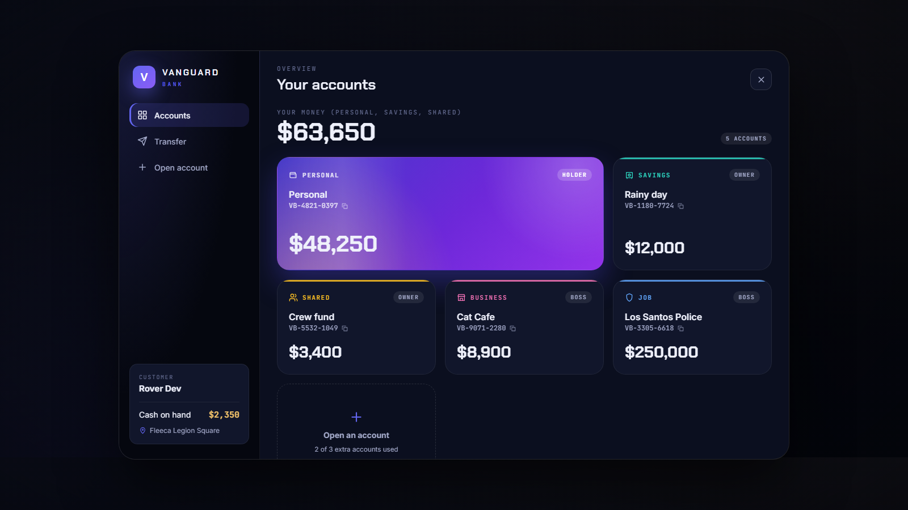
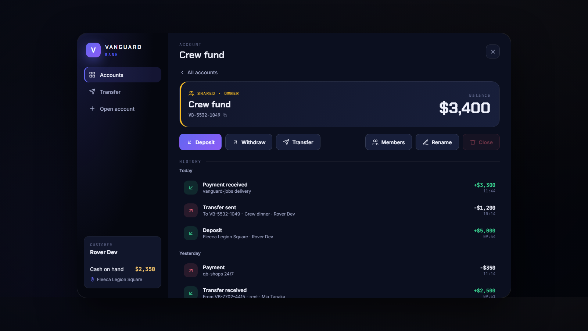
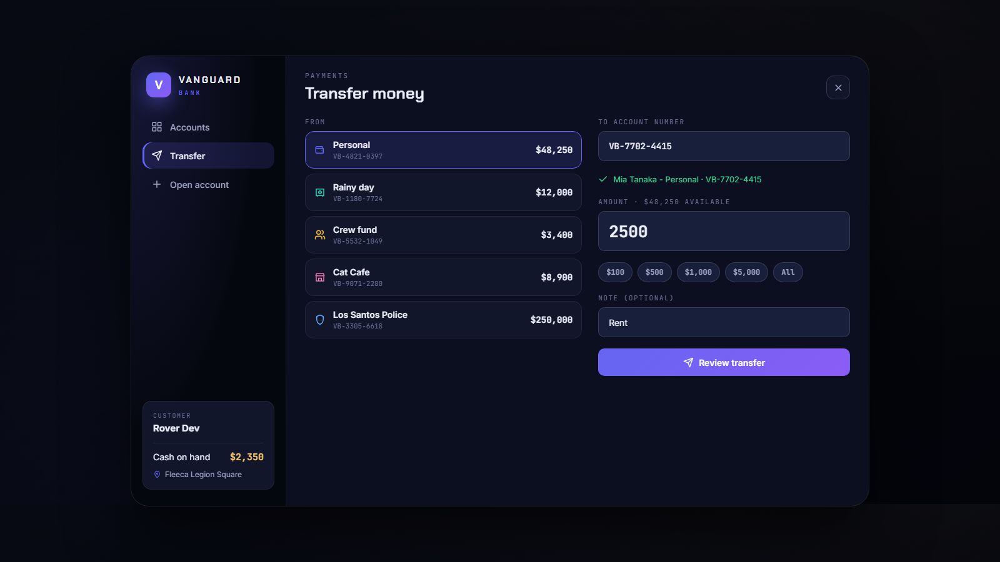
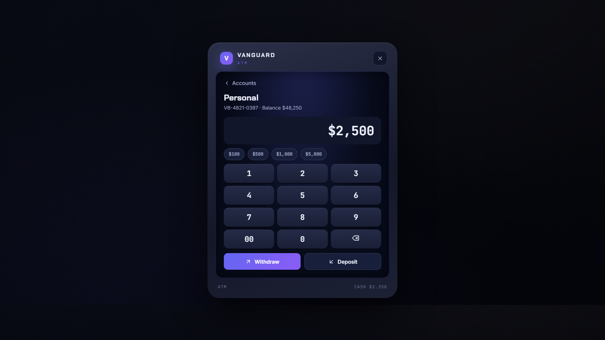

# Vanguard Bank

A modern bank for FiveM **QBCore** servers. Players walk up to a bank counter for full banking (accounts, transfers, opening accounts, shared accounts with members) or to an ATM for cash. Branches and ATMs are placed in game by admins, and the server checks every action against them.

It replaces **qb-banking**: scripts written for qb-banking keep working, and its accounts are copied over on first start. With **Vanguard Business** installed, business money lives in the bank too.



## Features

- **Branches** (press **E** at a placed counter): dashboard of all your accounts with live balances, history per account, deposit, withdraw, transfer to any account number (the owner's name shows before you confirm), open a new account, rename, close, manage members.
- **ATMs** (press **E** at a placed ATM): withdraw and deposit only, on any account you can use. No managing at an ATM.
- **Account types**

  | Account | Who sees it | Who can take money out |
  |---|---|---|
  | Personal | The character | The character (this is QBCore's normal `bank` money) |
  | Savings | Owner | Owner |
  | Shared | Owner and members | Owner and members with the **Member** role (**Viewer**: see + deposit) |
  | Business | Vanguard Business Owner and Manager ranks | Owner and Manager |
  | Job / Gang | The job's / gang's boss grade | Boss grade |

- **Open an account** in three steps (type, name, confirm) with a short "opening" animation; you get a number like `VB-4821-0397`. Up to 3 extra accounts per character (`Config.MaxOwnedAccounts`).
- **Full history** — Personal history also shows money other scripts move (paychecks, job payments, shops).
- **Transfers to offline players** arrive the moment they next log in.
- **Safe by design** — the server decides everything: who you are, your role on the account, that you are standing at a branch or ATM, the amount and the balance. Balances can never go below zero, not even with two people spending at once. Requests are rate-limited.





## Requirements

- `oxmysql`, `qb-core`
- Optional: `vanguard-business` 1.4.0 or newer (Business accounts)

## Installation

1. Put the `vanguard-bank` folder in your `resources` folder.
2. Remove (or move out) `qb-banking` — Vanguard Bank takes its place (`provide 'qb-banking'`).
3. In `server.cfg`, start it **right after qb-core**, before the scripts that use qb-banking, and give admins the placement tool:

   ```cfg
   ensure qb-core
   ensure vanguard-bank
   add_ace group.admin vanguard.bank.admin allow
   ```

4. Restart the whole server. Tables are created automatically, qb-banking's accounts are copied once, and the 8 standard bank counters are added as branches.
5. Check in the server console: `vbank_selftest` should print `qb-banking exports OK`.

## Placing branches and ATMs

Type **`/bankadmin`** (admins) to toggle placement mode:

| Key | Does |
|---|---|
| ← → | switch between **Branch counter** and **ATM** |
| Click | place (ATM: aim at an ATM until it lights up; Branch: aim at the counter, then type its name) |
| Mouse wheel | rotate |
| Delete | remove the branch / ATM you aim at |
| Backspace | done |

Only placed ATMs work — every other ATM on the map does nothing.

## qb-banking compatibility

Exports with the same names and arguments: `AddMoney`, `RemoveMoney`, `GetAccount`, `GetAccountBalance`, `GetBalance`, `CreatePlayerAccount`, `CreateJobAccount`, `CreateGangAccount`, `CreateBankStatement`, `AddGangMoney`, `RemoveGangMoney`, `GetGangAccount`. Callers use `exports['qb-banking']:...` unchanged.

## Development

```sh
npm install
npm test        # rules (Lua 5.3 via fengari)
npm run lint    # Lua syntax + app.js
npm run check   # both
```

Open `html/index.html` in a browser for a preview with sample data: `#bank`, `#account`, `#deposit`, `#transfer`, `#confirm`, `#open`, `#name`, `#opened`, `#members`, `#atm`, `#atmpick`, `#placement`, `#label`, `#loading`.

## License

MIT © 2026 Rover
